<p align="center">
  
</p>

<p align="center">
  <strong>A personal AI assistant with local (Ollama) and cloud (Claude) brains, voice control, and an animated interface.</strong>
</p>

<p align="center">
  
  
  
  
</p>

---

## Features

| | |
|---|---|
| 🧠 **Local AI** | Run models privately on your machine with Ollama |
| ☁️ **Cloud AI** | Switch to Anthropic Claude with one setting |
| 🎙️ **Voice** | Whisper speech recognition + text-to-speech |
| 🔧 **Tools** | Add new abilities with a single decorator |
| 🔴 **Animated UI** | Orb with idle, listening, thinking and speaking states *(planned)* |

## Quick Start

```bash
git clone https://github.com/AbhiramSakha/Sample_Jarvis_Preparetion.git
cd Sample_Jarvis_Preparetion

python -m venv venv
venv\Scripts\activate          # Linux/macOS: source venv/bin/activate
pip install -r requirements.txt

copy .env.example .env         # Linux/macOS: cp .env.example .env
```

Then pick a brain and edit `.env`:

| Backend | Setup | `.env` |
|---|---|---|
| **Ollama** (local, free) | Install [Ollama](https://ollama.com/download), run `ollama pull llama3.2` | `AI_PROVIDER=ollama`<br>`OLLAMA_MODEL=llama3.2`<br>`OLLAMA_BASE_URL=http://localhost:11434` |
| **Claude** (cloud) | Get an API key from Anthropic | `AI_PROVIDER=anthropic`<br>`ANTHROPIC_API_KEY=your_api_key` |

## Run

```bash
python main.py            # text mode
python main.py --voice    # voice mode: say "Jarvis, what time is it?"
```

## Add a Tool

Create a function in `tools/`, decorate it, and import the file in `tools/__init__.py`:

```python
from tools.registry import registry

@registry.register("tell_joke", "Tell the user a joke.")
def tell_joke():
    return "Why do programmers prefer dark mode? Because light attracts bugs."
```

Use `confirm=True` for anything risky.

## Troubleshooting

| Problem | Fix |
|---|---|
| Wakes on noise or ignores you | Tune `SILENCE_THRESHOLD` in `config.py` |
| Poor speech recognition | Set `WHISPER_MODEL = "small.en"` |
| No voice on Linux | `sudo apt install espeak-ng` |
| Ollama connection refused | Run `ollama serve` and check `OLLAMA_BASE_URL` |
| Model ignores tools | Use a tool-capable model such as `llama3.1` |

<details>
<summary><strong>Project structure</strong></summary>

```text
jarvis/
├── main.py
├── config.py
├── requirements.txt
├── .env.example
├── assets/jarvis-banner.svg
├── tools/
│   ├── __init__.py
│   └── registry.py
└── frontend/
    ├── index.html
    ├── style.css
    └── script.js
```

</details>

## Roadmap

- [x] Core assistant and tool registry
- [ ] Ollama integration
- [ ] Claude integration
- [ ] Animated interface with live voice visualization
- [ ] Desktop app and system automation

## Author

**Sakha Abhiram** · [@AbhiramSakha](https://github.com/AbhiramSakha)

<p align="center"><sub>J.A.R.V.I.S — Just A Rather Very Intelligent System</sub></p>
